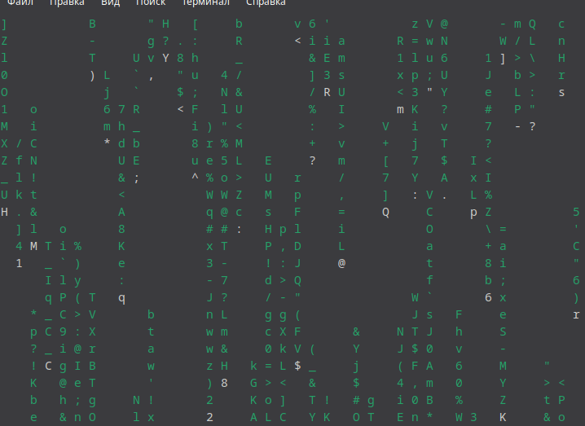

# Hi 👋, I'm k1rpit 

### 👋 About Me
- 👦 **Age:** Under 18 y.o.
- 🛡️ **Interests:** Deeply into **CyberSecurity**, Ethical Hacking & InfoSec
- 🐍 **Current Stack:** Writing security tools with **Python**
- 🐧 **OS:** Running on **Debian Linux** as my main system
- 🎯 **Next Goal:** Moving towards low-level security with **C** **or** **GO**

---

  

  

- Studying InfoSec and CyberSecurity through technical literature and hands-on coding. **Linux Sysadmin basics (Debian), Network Protocols (TCP/IP), Pentesting Automation|Self-learning via technical books, official documentation, and practical coding.**

- Developing a network scanner with a modular split-script layout. The first script targets open ports and honeypots, while the second performs asynchronous banner grabbing, communicating securely via local JSON states. [k1r-state-scanner-v1](https://github.com/k1rpit/k1r-state-scanner-v1)

- Developing a high-entropy username generation and pipeline mutation engine. Built on a strict separate architecture, it runs an internal mutation engine to fuzz, mutate, and adapt target strings for security auditing. [GENERATNIK-K1RPIT](https://github.com/k1rpit/GENERATNIK-K1RPIT)

- Developing a robust statistical processing engine and data analyzer on native Python. It calculates algorithmic variance, mathematical range, median thresholds, and a custom single-level trimmed mean to process audit payloads. [robust-stats-practice](https://github.com/k1rpit/robust-stats-practice)

- Developing Hasher-Core, an interactive CLI tool for cryptographic hashing (MD5, SHA-1, SHA-256, SHA-512) and randomized text salting. [Hasher-Core](https://github.com/k1rpit/Hasher-Core)

- 👨‍💻 All of my InfoSec tools are available at [https://github.com/k1rpit?tab=repositories](https://github.com/k1rpit?tab=repositories)

- 📝 I regularly read articles on [Python, Linux, and CyberSecurity](Python, Linux, and CyberSecurity)

- 💬 Ask me about **CyberSecurity scripting, Network scanning (Nmap), and Cryptographic hashing**

- 📫 How to reach me **t.me/k1rpit718s**

- 📄 Know about my experiences [t.me/k1rpit718s](t.me/k1rpit718s)

- ⚡ Fun fact **My computer only breathes Debian, everything else is bloatware.**

<h3 align="left">Connect with me:</h3>

<h3 align="left">Languages and Tools:</h3>

   

&nbsp;

